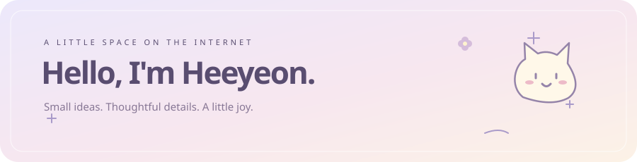

  

  작은 아이디어를 직접 만들고, 쓸 때마다 기분 좋아지는 디테일을 좋아해요.

  
  
  

 

<h3 align="center">🌱 My little garden</h3>

코드를 쓰는 날마다 조금씩 자라는, 나만의 작은 정원

<!-- doodle-garden:start -->

  

최근 30일 기여 5개마다 꽃 한 송이 · 매일 갱신 · 정원을 누르면 낙서 친구 프로젝트로 이동해요

<!-- doodle-garden:end -->

 

<h3 align="center">🧶 Things I work with</h3>

  
  
  
  

  
  
  
  

 

<h3 align="center">🐾 Made for a little company</h3>

  <strong>Doodle Buddy · 낙서 친구</strong> 
  내가 그린 캐릭터와 함께 코딩하는 VS Code 확장

  

  <a href="https://marketplace.visualstudio.com/items?itemName=CHOIHEEYOUN.doodle-buddy">Install extension</a> &nbsp; · &nbsp;
  <a href="https://github.com/heeyeon9578/doodle-buddy">View source</a>

 

  
🐣 My other little friends

   
  

    
  

 

Thanks for stopping by. Have a lovely day ☁️

